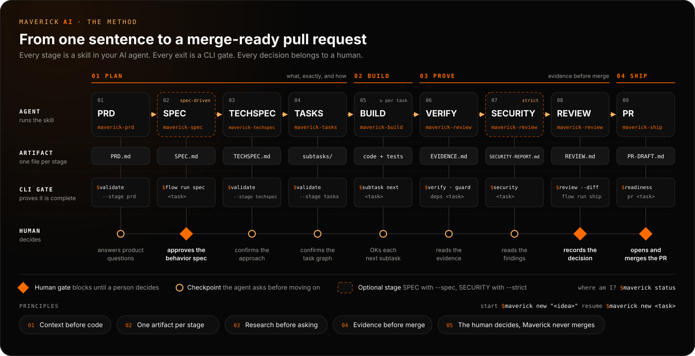
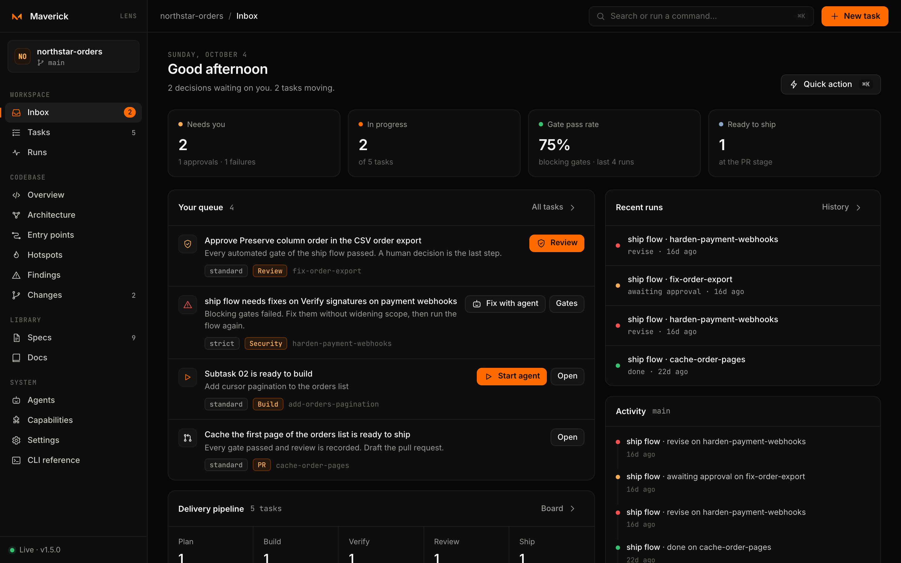
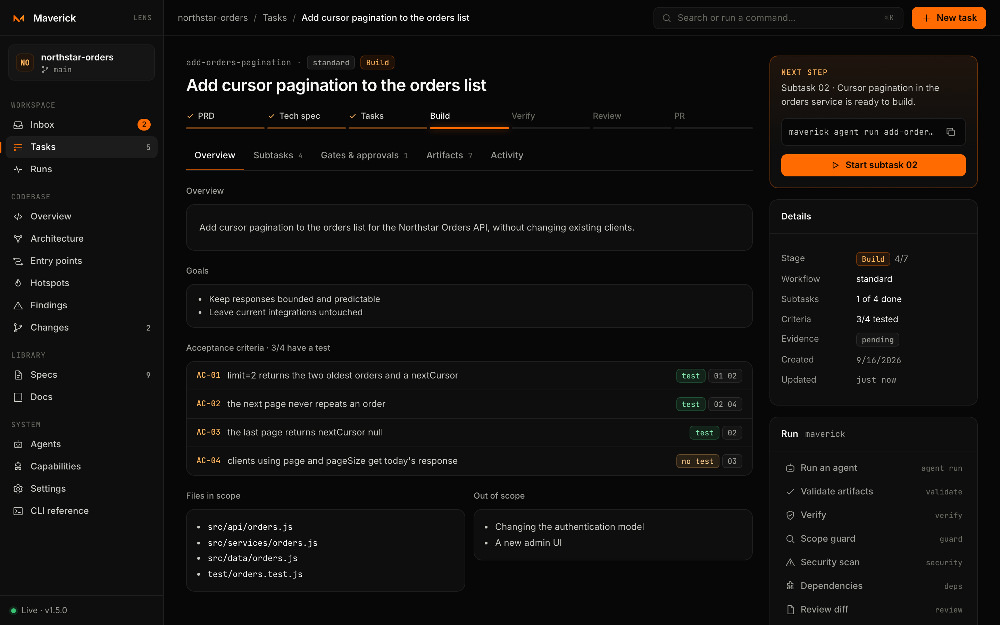
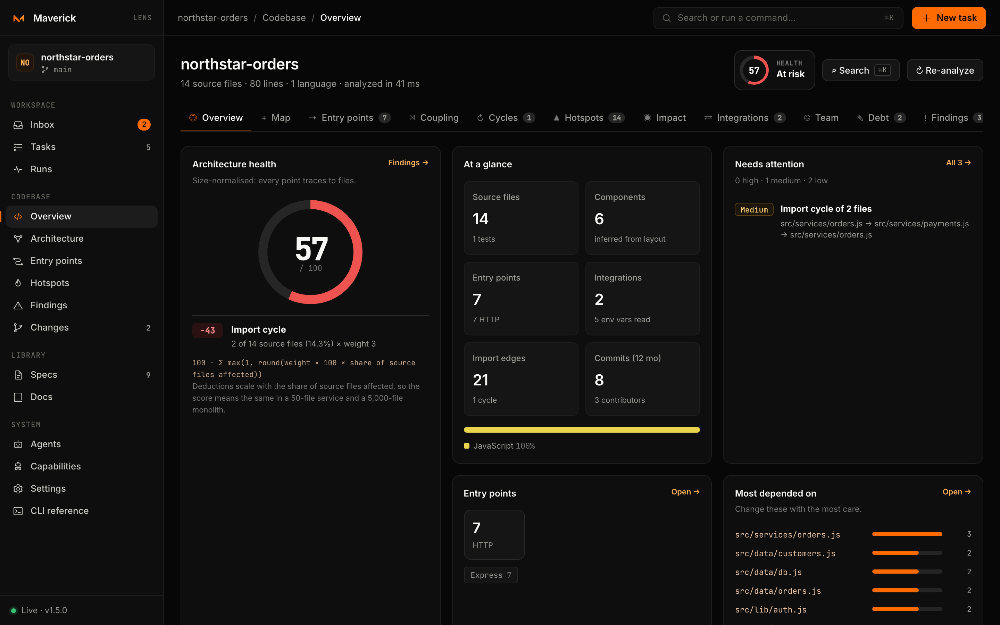
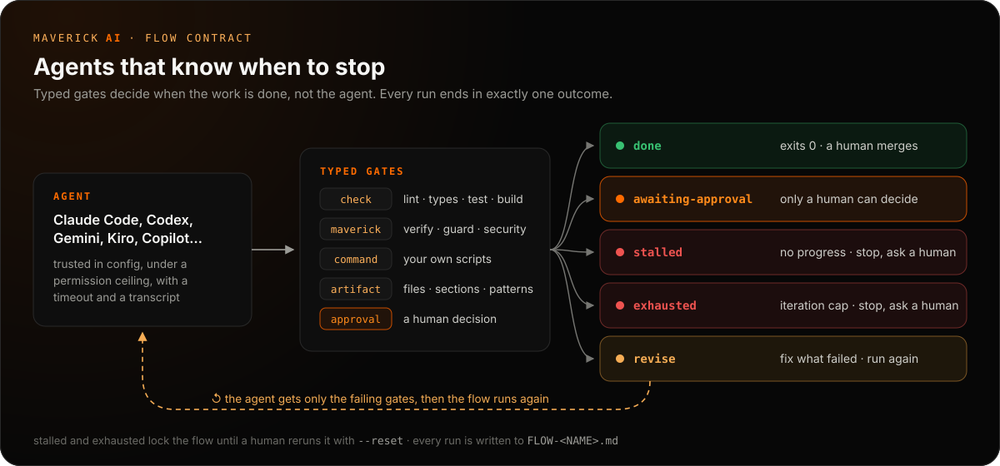

<p align="center">
  <picture>
    <source media="(prefers-color-scheme: dark)" srcset="site/public/brand/maverick-ai-logo-dark-tight.svg">
    
  </picture>
</p>

<h3 align="center">Your AI agent writes the code. Maverick makes it mergeable.</h3>

<p align="center">
  The open-source, local-first workflow layer for <b>Claude Code, Codex, Cursor, Gemini, Copilot, Kiro, Antigravity and OpenCode</b>.<br>
  One sentence in. A PRD, a spec grounded in your code, a task graph, recorded evidence and a pull request a human can defend, out.
</p>

<p align="center">
  <a href="https://www.npmjs.com/package/@maverick-ai/cli"></a>
  <a href="https://github.com/jhonesgoncalves/maverick-ai-dev-stack/actions/workflows/pipeline.yml"></a>
  <a href="https://jhonesgoncalves.github.io/maverick-ai-dev-stack/"></a>
  <a href="LICENSE"></a>
  <a href="package.json"></a>
  <a href="https://github.com/jhonesgoncalves/maverick-ai-dev-stack/stargazers"></a>
</p>

<p align="center">
  <a href="#get-started-in-60-seconds"><b>Quick start</b></a> ·
  <a href="#how-it-works">How it works</a> ·
  <a href="#see-a-real-task">A real task</a> ·
  <a href="#maverick-lens-your-delivery-cockpit">Lens</a> ·
  <a href="#bring-every-agent-you-use">Agents</a> ·
  <a href="https://jhonesgoncalves.github.io/maverick-ai-dev-stack/">Docs</a>
</p>

<p align="center">
  
</p>

```bash
npx @maverick-ai/cli init
```

<p align="center"><sub>Node 20+ · no account · no cloud · no telemetry · MIT</sub></p>

---

## AI made diffs cheap. Trust got expensive.

You ask your agent for pagination. Twenty minutes later it hands you 1,200 lines across 14 files, a new dependency, a touched auth guard and *"all tests pass."*

Which tests? Was the guard in scope? What did you actually ask for? The chat is already gone, and the reviewer is left reverse-engineering intent from a diff.

Maverick moves that work **before** the diff and keeps the receipts **after** it:

| | Prompt → diff | Prompt → **Maverick** → diff |
|---|---|---|
| **What was asked** | A chat you closed | `PRD.md`: user stories and `AC-01` *Given / when / then* criteria |
| **What the agent may touch** | Whatever it decides | `TECHSPEC.md` file references and a do-not-touch list; `guard` flags the rest |
| **"Tests pass"** | Trust me | `EVIDENCE.md`: every command, exit code and output |
| **Security and dependencies** | Hope | `SECURITY-REPORT.md` and `DEPENDENCY-REVIEW.md` for the diff |
| **When the agent stops** | When it feels done | A contract: `done`, `revise`, `awaiting-approval`, `stalled` or `exhausted` |
| **An agent left running** | Grades its own work, may "fix" tests | `maverick loop`: the harness checks every iteration, rolls back regressions and weakened tests, and records it all |
| **Who said "ship it"** | ¯\\\_(ツ)\_/¯ | A human decision, recorded in `REVIEW.md` |

**Maverick is not another coding agent.** Keep the one you like, or the five your team already uses. Maverick is the workflow around them, and it works the same way in all of them.

## Get started in 60 seconds

```bash
cd your-repo
npx @maverick-ai/cli init
npx @maverick-ai/cli new "Add cursor pagination to the orders endpoint"
npx @maverick-ai/cli lens --open
```

1. **`init`** interviews you: what the project does, which agents work on it, the language of the docs and of the code, the default workflow and the verification commands. It writes the ten flow skills once to `.agents/skills/` and links every agent to them (`.claude/skills → ../.agents/skills`). Every question has a flag, and `--yes` takes the suggestions.
2. **`new`** derives a slug, picks a workflow, grounds the idea in your code (ranked files, tests, entry points, shared modules) and opens your agent with the right skill: your configured default, or the first of Claude Code, Codex, Cursor, Gemini, Antigravity, Copilot, Kiro and OpenCode it finds (`--agent` picks one). **From there, everything happens inside your agent.**
3. **`lens`** opens a local cockpit on `127.0.0.1` to follow tasks, run gates and agents, and explore the architecture.

Already inside an agent? Ask it to use the `maverick-new` skill (`/maverick-new <idea>` in Claude Code). Prefer a global command? `npm install --global @maverick-ai/cli`, then `maverick` (with no arguments it opens an interactive launcher).

> [!TIP]
> **Try it on a realistic project first.** Clone this repository and run `bash examples/nestjs-orders-api/scripts/setup-playground.sh`. You get a NestJS API in its own Git repository with problems planted for Maverick to find (an import cycle, an unguarded webhook, hotspots across three authors) and a planned task to take from PRD to PR.

## How it works

<p align="center">
  <a href="https://jhonesgoncalves.github.io/maverick-ai-dev-stack/guide/method"></a>
</p>

Every stage is a **skill** in your agent, every exit is a **CLI gate**, and every decision belongs to a **human**.

| Phase | Skill in your agent | Writes | Exits through |
|---|---|---|---|
| **Plan** | `maverick-prd` → `maverick-spec`¹ → `maverick-techspec` → `maverick-tasks` | `PRD.md`, `SPEC.md`¹, `TECHSPEC.md`, `subtasks/` | `maverick validate` |
| **Build** | `maverick-build` | Code and tests, one ready subtask at a time | `maverick verify` |
| **Prove** | `maverick-review` | Evidence, scope, security, dependency and review reports | `maverick flow run ship` |
| **Ship** | `maverick-ship` | `MERGE-READINESS.md` and `PR-DRAFT.md` | **You.** Maverick never merges. |

<sub>¹ spec-driven workflow only. Three more skills keep you oriented: `maverick-new` runs the planning stages, `maverick-status` says where every task stands and what is next, and `maverick-sync` upgrades skills and older tasks.</sub>

**Nothing is a template.** Each planning skill researches the code first, asks only what the code cannot answer (one question at a time, through your agent's answer picker, with a recommendation first), writes the artifact in full, validates it and asks before moving on. The technical spec cites real `path:line` references; the Test Plan maps every `UT-01` to an `AC-01`; validation fails on paths that do not exist and criteria nobody tests.

**The right amount of ceremony for each change.** `maverick new` reads the idea and picks the workflow; `--workflow`, `--spec` and `--strict` override it.

| Workflow | Picked for | Pipeline |
|---|---|---|
| `standard` | Everyday features, fixes and refactors | PRD → TECHSPEC → TASKS → build → verify → review → PR |
| `spec-driven` | APIs, endpoints, webhooks, integrations, shared contracts | Adds a behavioral `SPEC.md` (`SC-01` scenarios, contracts, invariants) that a human approves before design starts |
| `strict` | Security, payments, data, migrations, shared infrastructure | Adds a security gate before review |

**Your language, your code's language.** Documents can be written in English, Brazilian Portuguese or Spanish (`## Critérios de Aceite`, `QUANDO … ENTÃO`) while identifiers, tests and commit messages stay in the code's language: `maverick language pt-BR en`.

## What lands in your repo

Plain Markdown next to your code, reviewable in Git. No database, no server, no lock-in.

```text
.maverick/tasks/add-cursor-pagination-orders-endpoint/
├── TASK.json               the idea and the workflow
├── PRD.md                  goals, US-01 stories, AC-01 criteria, edge cases, non-goals
├── SPEC.md                 behavior, SC-01 scenarios, contracts, invariants (spec-driven)
├── TECHSPEC.md             current state (path:line), approach, test plan, rollback
├── subtasks/               _tasks.md owns the dependency graph, task_NN.md owns each status
├── EVIDENCE.md             every verification command with its exit code and output
├── SCOPE-GUARD.md          changed files versus the files the spec declared
├── SECURITY-REPORT.md      high-signal risks in the diff
├── DEPENDENCY-REVIEW.md    changed manifests and lockfiles
├── REVIEW-FINDINGS.md      diff review with the blast radius of each change
├── REVIEW.md               every acceptance criterion, checked, and the human decision
├── FLOW-SHIP.md            the last flow run, gate by gate
├── MERGE-READINESS.md      outstanding gates before merge
├── PR-DRAFT.md             an evidence-backed pull request description
└── runs/                   JSONL transcripts of every headless agent run (git-ignored)
```

### See a real task

[`examples/nestjs-orders-api/.maverick/tasks/add-cursor-pagination-orders-endpoint`](examples/nestjs-orders-api/.maverick/tasks/add-cursor-pagination-orders-endpoint) is a spec-driven task on a real NestJS API, planned in Brazilian Portuguese and built by headless Codex and Claude Code runs, one subtask at a time. Read the [PRD](examples/nestjs-orders-api/.maverick/tasks/add-cursor-pagination-orders-endpoint/PRD.md), the [behavioral spec](examples/nestjs-orders-api/.maverick/tasks/add-cursor-pagination-orders-endpoint/SPEC.md), the [evidence](examples/nestjs-orders-api/.maverick/tasks/add-cursor-pagination-orders-endpoint/EVIDENCE.md) and the [transcripts](examples/nestjs-orders-api/.maverick/tasks/add-cursor-pagination-orders-endpoint/runs), including the Antigravity run that hit its quota. Failures are evidence too.

## Maverick Lens: your delivery cockpit

`maverick lens --open` turns the same files into a local web app. Nothing leaves your machine: it binds to loopback only, every write needs a per-process token, and the server makes no outbound requests.

<p align="center">
  
</p>

<table>
  <tr>
    <td width="50%"></td>
    <td width="50%"></td>
  </tr>
  <tr>
    <td><b>Every task, traced.</b> Stages, the next step and its command, each acceptance criterion linked to its tests and subtasks, gates and the approval form.</td>
    <td><b>Your architecture, explained.</b> A health score whose every point traces to files, entry points, coupling, cycles, hotspots, impact and bus factor.</td>
  </tr>
</table>

- **Inbox** lists what needs you: approvals, failing flows, broken subtask graphs, ready subtasks and tasks ready to ship, each with its action.
- **Run from Lens**: start a trusted agent on the next subtask, let it **fix** a failed flow, run `verify`, `guard` or `review`, and follow every event live. Same commands, same permission ceilings as the CLI.
- **Devtools**: an application map from clients to integrations, every entry point with a ready-to-run `curl`, Martin coupling metrics, change coupling, ownership and ranked findings you can turn into a task. A command palette on `⌘K` reaches all of it from any view.

Read the [Lens documentation](https://jhonesgoncalves.github.io/maverick-ai-dev-stack/lens/).

## Agents that know when to stop

AI agents loop well and stop badly. A **flow** gives them a goal, typed gates and a contract that ends every run in exactly one outcome, so an agent can iterate on its own without looping forever, or "fixing" what only a human can decide.

<p align="center">
  
</p>

```bash
maverick flow run fix-checks my-task --agent      # the agent fixes lint, types and tests
maverick flow run ship my-task                    # every evidence gate, up to the human
maverick flow approve ship my-task human-review   # the human decision, on the record
```

Only `done` exits zero. After `stalled` or `exhausted` the flow refuses to run until a human passes `--reset`. A missing approval is `awaiting-approval`, never `revise`. If you do want a flow to approve itself once every blocking check passes, `--auto-approve` says so on the record.

<details>
<summary><b>Write your own flow</b></summary>

Add flows to `.maverick/flows/<name>.yaml`. Gates are typed, never free text: `check` (the detected lint, typecheck, test and build), `maverick` (validate, verify, guard, integrity, ablation, architecture, contracts, attention, security, deps, policy, review, readiness), `command`, `artifact` (file, sections, pattern), `approval`, `judge` (an independent agent from another model family that decides the criteria) and `sealed` (the task's hidden acceptance tests). Gates with `severity: warn` report without blocking.

```yaml
apiVersion: maverick.flow/v1
name: api-change
description: Contract checks for public API changes.
contract:
  goal: The API change for {{task}} is compatible and signed off.
  iterationCap: 3
  noProgressWindow: 2
gates:
  - { id: checks, type: check, kinds: [lint, test] }
  - { id: contract-tests, type: command, run: make contract-test }
  - { id: api-owner, type: approval, prompt: API owner approves the change }
```

Large tasks become a dependency graph that agents follow in order. Cycles, unknown statuses and unlisted files fail validation:

```bash
maverick subtask add my-task "Add pagination to the API" --type backend
maverick subtask add my-task "Render the paginated list" --after 01 --type frontend
maverick subtask next my-task --json
maverick subtask set my-task 01 done
```

</details>

## Loops you can leave running

A loop builds a planned task subtask by subtask with a fresh agent context each time. The agent writes code; **Maverick decides every iteration** with evidence it collects itself, so the loop cannot grade its own work.

```bash
maverick loop run my-task --dry-run                   # the plan, the oracle and the first prompt
maverick loop run my-task --max-iterations 8 --judge  # build it, within a budget
maverick loop status my-task                          # or follow it live in Lens → Loops
maverick loop verify my-task                          # the record still matches every checkpoint
```

- **Integrity guard.** Every diff is audited for deleted, skipped or focused tests, fewer or looser assertions, silenced lint or types, and edits to check configuration or CI, in twelve languages. An agent that thinks a check is wrong reports a dispute instead of changing it.
- **Ratchet with rollback.** Each iteration is a checkpoint. A gate that passed never fails again, and the import structure never gets worse; anything worse is rolled back automatically.
- **Feedback that does not teach evasion.** The next agent learns which criterion is unmet and which visible check regressed, never which integrity rule caught it or how the judge reasoned (`loop.feedback`). Notes from an iteration kept despite integrity warnings are quarantined until you release them.
- **Escalation across vendors.** No progress, oscillation, churn or overclaiming climbs a ladder: the diagnosis, more reasoning, another vendor, then you, with an escalation packet.
- **Cross-family judge.** With `--judge`, a reviewer from a different model family, working read-only on an export of the change, must accept each subtask. It sees the diff and the harness's evidence, never the author's explanation.
- **Budgets with a forecast, and a ledger.** Iteration, time, token and cost limits stop the loop *before* an iteration that would cross them; tokens are counted for every provider that reports them, and `runtime.prices` turns them into a cost. Every decision is in a hash-chained ledger tied to the checkpoint commits, and a resumed loop records whatever changed while it was stopped.

In place, checkpoints are hidden refs: your HEAD, branch and index are never touched. With `--worktree`, the loop works on its own branch outside your checkout. A loop never commits to your branch and never pushes; only the `pr` flow does, after you approve the pull request draft. Read [Loop engineering](https://jhonesgoncalves.github.io/maverick-ai-dev-stack/concepts/loop-engineering).

## Tests the agent never sees

**Agents write. Maverick proves. Engineers decide.** An agent that sees every test learns to pass the tests. Sealed tests are acceptance tests written from your PRD and spec *before* the build, by another model family (or by you), encrypted outside the work tree and run only at milestones. The loop is done only when they pass too; when they do not, you get the **overfitting index**: how much the visible checks promised beyond what the hidden tests confirm.

```bash
maverick seal my-task                     # an independent sealer writes the suite, read-only
maverick seal approve my-task             # after reading it: maverick seal status my-task --reveal
maverick loop run my-task --judge
# HOLDOUT-GAP — the visible checks pass, the sealed tests do not: 7/10 sealed pass · overfitting index +33 pp
maverick unseal my-task --commit --protect  # at review: keep them as protected regression tests
```

- **Independent by construction.** The sealer comes from a model family no builder belongs to; a loop whose builder shares it refuses to start.
- **Never leaks.** The suite runs only in exports outside the repository. No file, git object, prompt or temporary file holds it, and Maverick's own tests check exactly that. The task keeps digests and counts; the tests are for you, at a terminal.
- **Never a hidden oracle.** A sealed failure never rolls work back; it goes to a human. Hill-climbing on a holdout leaks it.
- **Checks of the checks.** `maverick ablation` proves new tests fail without the change (a test that cannot fail is not evidence), and `maverick structure` fails a change that adds an import cycle or breaks an architecture rule.

Sealing keeps tests out of the prompt, out of the tree and out of casual reach; it is not cryptographic secrecy against an agent with a full shell. Read [Sealed tests](https://jhonesgoncalves.github.io/maverick-ai-dev-stack/concepts/sealed-tests).

## Why every line exists

`git blame` says who and when. `maverick why` says why: the task, the acceptance criterion, the loop iteration and agent that wrote the line, the checks it passed, the judges and the human who approved it, and the contracts that guard it now.

```bash
maverick why src/orders/orders.service.ts:88
# Task      add-cursor-pagination  (PR #42, done 2026-10-12)
# Intent    AC-02 The cursor is opaque to the client
# Built     subtask 02 · loop 20261012-101500-ab12 · iteration 4 · codex gpt-6 (high) · accepted
# Proven    checks PASS (checks, keep) · integrity clean · sealed 10/10
# Decided   judge claude (anthropic) 0.91 PASS · human review: approve
# Guards    contract C-07 "The cursor is opaque to the client"
```

- **Living contracts.** A finished task leaves its invariants and the criteria its sealed tests proved as contracts. The next change that touches those files sees them, and must keep them or revoke them in its PRD.
- **The error ratchet.** Every rollback, judge rejection, escalation and dispute becomes a proposed rule. You accept or reject it; accepted rules reach an agent only when it touches their paths, and each one is measured to see whether its mistake stopped recurring.
- **A review budget.** `maverick attention` ranks the diff's hunks by risk and gives a time range and a proof tree per criterion, so the reviewer knows where to look first.

Read [Memory](https://jhonesgoncalves.github.io/maverick-ai-dev-stack/concepts/memory).

## Bring every agent you use

One workflow, the same files, any assistant. Switch tools mid-task: the next agent reads the same PRD, spec and subtasks.

| Agent | Flow skills | Instructions | Headless runs | MCP server |
|---|:-:|---|:-:|:-:|
| Claude Code | ✓ | `CLAUDE.md` | ✓ | ✓ |
| OpenAI Codex | ✓ | `AGENTS.md` | ✓ | ✓ |
| Cursor | ✓ | `.cursor/rules/maverick.mdc` | ✓ | ✓ |
| Gemini CLI | ✓ | `GEMINI.md` | ✓ | ✓ |
| GitHub Copilot | ✓ | `.github/copilot-instructions.md` | ✓ | ✓ |
| Kiro | ✓ | `.kiro/steering/maverick.md` | ✓ | ✓ |
| OpenCode | ✓ | `AGENTS.md` | ✓ | ✓ |
| Google Antigravity | ✓ | `.agents/rules/maverick.md` | ✓ | user-level |
| Windsurf | ✓ | `.windsurf/rules/maverick.md` | — | user-level |
| Anything else | — | `.maverick/ROLE_PROMPT.txt` | `runtime.custom` | — |

### Headless agents, within limits

Maverick drives the agent CLIs you already have, with the prompt built from the PRD, spec and subtask, and normalized events streamed back:

```bash
# trust a provider: a reviewed change to .maverick/config.json
maverick agent trust claude-code --max-permission edit --yes

# implement the next ready subtask, or hand any agent a read-only job
maverick agent run my-task --subtask next
maverick agent run my-task --provider codex --permission read-only --prompt "Review the diff"

# the default agent, model and reasoning for a workflow step
maverick agent stage build --provider codex --effort high
```

- **Trust is a reviewed decision.** Only providers in `runtime.trusted` run, and `agent trust` writes that list to a file your team reviews.
- **Configuration is the ceiling.** `read-only`, `edit` and `full` map to each tool's own flags; a run can lower the level but never exceed `runtime.maxPermission`. Where the tool has an allow-list, `edit` pre-approves only your verification commands and read-only Git.
- **No side effects.** Agents are told not to commit, push, open pull requests or touch credentials, and must end with a `done`, `blocked` or `needs-input` result. A flow stops as soon as an agent asks for a human. An agent that believes a check is wrong reports it as a dispute instead of changing it.
- **Bounded and auditable.** Timeouts, iteration caps and stall detection end every run; every run leaves a JSONL transcript.
- **The right model per step.** Planning gets the strongest model with high reasoning, building the coding workhorse, fixing a lighter setting. Override per run with `--model` and `--effort`, or route by subtask type and complexity.

<details>
<summary><b>Runtime configuration: stages, routes, custom CLIs and hooks</b></summary>

```json
{
  "runtime": {
    "trusted": ["claude-code", "codex", "aider"],
    "maxPermission": "edit",
    "default": { "provider": "claude-code", "model": "sonnet" },
    "stages": {
      "techspec": { "provider": "claude-code", "model": "opus", "effort": "xhigh" },
      "build": { "provider": "codex", "model": "gpt-6-sol", "effort": "high" }
    },
    "routes": [
      { "match": { "type": "frontend" }, "provider": "codex" },
      { "match": { "complexity": "high" }, "provider": "claude-code", "model": "opus", "effort": "xhigh" }
    ],
    "custom": [{ "id": "aider", "command": "aider --yes --model {model} --message {prompt}", "permissions": ["edit"] }]
  },
  "hooks": [
    { "event": "before-agent-run", "run": "scripts/agent-guard.sh" },
    { "event": "after-flow-run", "run": "scripts/notify.sh" }
  ]
}
```

Precedence is flags, then `routes`, then the step in `stages`, then `default`. Hooks receive the event as JSON on stdin: exit `0` allows (a `before-agent-run` hook may print `{"appendPrompt": "..."}`), exit `2` denies with stderr as the reason. A failing `before-agent-run` hook fails closed; `after-*` hooks only warn.

</details>

## Know the blast radius before you touch it

Maverick resolves static imports to real files across JavaScript/TypeScript, Python, Go, Rust, Java/Kotlin, C#, Ruby, PHP, Elixir, Dart and C/C++, through workspaces, `tsconfig` paths and module systems. Nothing is executed and nothing is uploaded.

```bash
maverick impact src/orders/orders.service.ts   # dependents, entry points, tests to run
maverick routes --kind http                    # HTTP, pages, GraphQL, gRPC, events, jobs
maverick graph --format mermaid                # cycles, hubs and a health score
maverick coupling                              # Ca, Ce, instability, boundary rules
maverick hotspots --since "6 months ago"       # where change and coupling meet
maverick audit --fail-on high                  # ranked findings with evidence: a CI gate
```

**Give the same intelligence to your agent.** `maverick mcp` is a read-only MCP server with `project_overview`, `list_tasks`, `get_task`, `next_subtasks`, `ground_change`, `impact`, `graph_summary`, `list_routes`, `architecture`, `audit` and `search_capabilities`. Register it in every tool at once:

```bash
maverick add mcp/maverick --to claude-code,cursor,gemini --allow-exec
```

<details>
<summary><b>How the numbers are computed</b></summary>

- **Health** is `100 − Σ max(1, round(weight × 100 × share of source files affected))` over import cycles (weight 3), hub files (2) and boundary violations (3). It means the same in a 50-file service and a 5,000-file monolith, and every deduction lists its files.
- **Cycles** use Tarjan's algorithm over static imports; a lazy `import()` counts for impact but not for cycles, because it is a deliberate runtime boundary.
- **Entry points** come from decorators and annotations (NestJS, Spring, JAX-RS, ASP.NET, FastAPI, Flask, Actix, Symfony…), router calls (Express, Fastify, Hono, Gin, Echo, Fiber, chi, Laravel, Rails, Phoenix, Ktor, Vapor…), file-system routing (Next.js, Nuxt, SvelteKit, Remix, Astro) and contracts (OpenAPI, GraphQL SDL, protobuf).
- **Coupling** uses Robert C. Martin's metrics per component (inferred from the layout or declared in `architecture.components`), the Stable Dependencies Principle and your own `architecture.rules`.
- **Hotspots** rank files by `commits × (1 + fan-in) × log10(10 + lines)` from Git history.
- `maverick review <task> --diff` adds the blast radius of the change to `REVIEW-FINDINGS.md`.

</details>

## Works with any stack

`maverick verify` detects your stack from manifest files (nothing runs during detection) and runs the checks your ecosystem expects. `Makefile`, `justfile` and `Taskfile.yml` targets named `lint`, `typecheck`, `test` or `build` win, because they are your project's own intent.

| Ecosystem | Detected from | Default checks |
|---|---|---|
| JavaScript / TypeScript | `package.json` (npm, pnpm, yarn, bun) | `lint`, `typecheck`, `test`, `build` scripts |
| Python | `pyproject.toml`, `requirements*.txt`, `Pipfile` | ruff/flake8, mypy/pyright, pytest/unittest/Django |
| Go | `go.mod` | `go vet` or golangci-lint, `go test ./...`, `go build ./...` |
| Rust | `Cargo.toml` | `cargo clippy`, `cargo check`, `cargo test`, `cargo build` |
| Java / Kotlin | `pom.xml`, `build.gradle(.kts)` | `test`, `package` / `assemble` (wrappers preferred) |
| C# / F# | `*.sln`, `*.csproj`, `*.fsproj` | `dotnet format`, `dotnet test`, `dotnet build` |
| Ruby, PHP, Elixir, Dart/Flutter, Swift | `Gemfile`, `composer.json`, `mix.exs`, `pubspec.yaml`, `Package.swift` | rspec/rubocop, phpunit/pest/phpstan, mix, flutter/dart, swift |

Monorepos work too: first-level folders such as `backend/` and `frontend/` are verified as subprojects. `maverick stack` shows exactly what `verify` will run.

<details>
<summary><b>Override the checks</b></summary>

```json
{
  "verification": {
    "commands": ["cargo nextest run", { "name": "e2e", "command": "npm run e2e", "cwd": "web" }],
    "kinds": ["lint", "test"],
    "subprojects": "auto"
  }
}
```

Commands run without a shell; use a task-runner target for pipelines or `&&` chains. Configuration is layered (built-in defaults, then `~/.maverick/config.json` or `$MAVERICK_HOME`, then the project), validated on load and shown by `maverick config show`.

</details>

## One capability, every tool

Write a skill, agent, command or MCP server once and install it into every AI tool the repository uses, with a plan before every write, key-by-key merges of shared files, a hashed lockfile and rollback on failure.

```bash
maverick catalog                    # built-in agents, skills, commands and MCP servers
maverick add reviewer --to claude-code,cursor,codex --dry-run
maverick installed                  # versions, drift and available updates
maverick sync                       # update, add new flow skills, restore edited files
```

<details>
<summary><b>Where each capability is installed</b></summary>

| Kind (entry file) | Claude Code | Codex | Cursor | Copilot | Gemini CLI | Kiro | OpenCode | Windsurf |
|---|---|---|---|---|---|---|---|---|
| Skill (`SKILL.md`) | `.claude/skills/` | `.agents/skills/` | `.cursor/skills/` | `.github/skills/` | `.gemini/skills/` | `.kiro/skills/` | `.opencode/skills/` | `.windsurf/skills/` |
| Agent (`AGENT.md`) | `.claude/agents/` | `.codex/agents/*.toml` | `.cursor/agents/` | `.github/agents/` | `.gemini/agents/` | `.kiro/agents/` | `.opencode/agents/` | — |
| Command (`COMMAND.md`) | `.claude/commands/` | — | use skills | `.github/prompts/` | `.gemini/commands/` | — | `.opencode/commands/` | `.windsurf/workflows/` |
| MCP server (`MCP.json`) | `.mcp.json` | `.codex/config.toml` | `.cursor/mcp.json` | `.vscode/mcp.json` | `.gemini/settings.json` | `.kiro/settings/mcp.json` | `opencode.json` | user-level |

Google Antigravity shares Codex's `.agents/skills/`. Skills are written once to `.agents/skills/` and linked into each tool (`capabilities.layout: "linked"`, the default except on Windows). Files and keys Maverick did not create are never overwritten without `--force`; in `.codex/config.toml` it owns only its `[mcp_servers.<name>]` tables. MCP servers that start a process need `--allow-exec`. Commit `.maverick/capabilities.lock.json` so `installed`, `sync` and `doctor` can detect drift.

A capability is a folder with one entry file. Agents declare portable permissions (`read`, `edit`, `shell`, `web`), and commands use `{{ARGUMENTS}}`, translated to each tool's syntax:

```markdown
---
name: release-notes
description: Drafts release notes from merged changes. Use when preparing a release.
version: 1.0.0
argument-hint: <version>
---

Draft release notes for {{ARGUMENTS}} from the commits since the previous tag.
```

</details>

## For teams and CI

```bash
maverick ci github my-task          # a GitHub Actions gate for one task
maverick audit --fail-on high       # fail the build on high-severity architecture findings
maverick policy init                # a change budget and sensitive paths, as a file
maverick handoff my-task --to ana   # remaining gates and context for whoever picks it up
maverick learn my-task --rule "Run focused tests before requesting review."
```

Most commands take `--json`. Policies, flows, trust lists and permission ceilings are plain files, so they change through code review like everything else. Proposed learnings stay proposals until a human promotes them.

## FAQ

**Is this another coding agent?**
No. Maverick never writes your code. It plans with your agent, gives it scoped context, checks what it did and records who decided. Use it with the agent you already pay for.

**Does my code leave my machine?**
Not because of Maverick. It runs locally, collects no telemetry, and Lens makes no outbound requests. Your agent talks to its own provider exactly as it does today.

**Isn't a PRD and a spec too much for a small change?**
The skills ask only what the code cannot answer, so a small change gets a short PRD. For a one-line typo, skip Maverick. Use it where someone has to defend the change in review.

**Do I have to adopt everything?**
No. Start with `new` and `verify`. Lens, flows, headless agents, capabilities and the MCP server are there when you want them, and every artifact is a Markdown file you can read without Maverick.

**What if I stop using it?**
Delete `.maverick/` and the skill folders. Your code never depended on it.

<details>
<summary><b>Every command</b></summary>

```text
Get started      init · language · status · doctor · lens
Plan & build     new · instructions · generate · validate · subtask · packet
Verify & review  verify · checkpoint · guard · integrity · security · deps · review · readiness · policy
Deliver          pr · handoff · learn · ci github
Flows            flow list · show · validate · run · status · approve · auto-approve
Loops            loop run · status · stop · verify · log · clean
Agents           agent list · trust · untrust · stage · run · runs · adapter · mcp
Intelligence     map · stack · graph · coupling · routes · hotspots · impact · audit
Capabilities     catalog · add · remove · installed · sync
Configuration    config show · validate · path · info · help
```

`maverick help <command>` explains any of them. The [CLI reference](https://jhonesgoncalves.github.io/maverick-ai-dev-stack/reference/cli) has every option.

</details>

## Documentation

| Start | Go deeper | Reference |
|---|---|---|
| [Getting started](https://jhonesgoncalves.github.io/maverick-ai-dev-stack/guide/getting-started) | [The Maverick Method](https://jhonesgoncalves.github.io/maverick-ai-dev-stack/guide/method) | [CLI](https://jhonesgoncalves.github.io/maverick-ai-dev-stack/reference/cli) |
| [Your first task](https://jhonesgoncalves.github.io/maverick-ai-dev-stack/guide/first-task) | [From idea to tasks](https://jhonesgoncalves.github.io/maverick-ai-dev-stack/guide/planning) | [Configuration](https://jhonesgoncalves.github.io/maverick-ai-dev-stack/reference/config) |
| [Maverick Lens](https://jhonesgoncalves.github.io/maverick-ai-dev-stack/lens/) | [Devtools](https://jhonesgoncalves.github.io/maverick-ai-dev-stack/lens/devtools) | [Task artifacts](https://jhonesgoncalves.github.io/maverick-ai-dev-stack/reference/artifacts) |
| [NestJS playground](examples/nestjs-orders-api) | [Maverick Lab](https://jhonesgoncalves.github.io/maverick-ai-dev-stack/lab/introduction) | [Changelog](CHANGELOG.md) |

## Contributing

Contributions are welcome, especially ones that make AI-assisted engineering more explainable, testable and secure across tools.

```bash
git clone https://github.com/jhonesgoncalves/maverick-ai-dev-stack.git
cd maverick-ai-dev-stack
npm install
npm run dev -- doctor      # the CLI from this checkout
npm run check              # lint, typecheck, tests and build
npm run docs:dev           # the documentation site
npm run lens:example       # a screen-safe Lens demo on 127.0.0.1:4175
```

Read the [contribution guide](CONTRIBUTING.md) and the [code of conduct](CODE_OF_CONDUCT.md), start your change with `maverick new`, and put the verification evidence in your pull request. The [roadmap](ROADMAP.md) shows where the project is going.

**Releases are automatic.** The pipeline (`.github/workflows/pipeline.yml`) runs the documentation checks, lint, type checks, CLI and demo tests, the package build and a package dry-run on Node 20 and 24 for every pull request and push to `main`. Every push to `main` that passes is versioned from its Conventional Commits (`feat:` minor, `!` or `BREAKING CHANGE:` major, anything else patch), tagged, released on GitHub with its `CHANGELOG.md` section as the notes (the entries under `[Unreleased]` move under the new version) and published to npm with trusted publishing and provenance, and then the documentation is deployed from the release commit. Do not bump `package.json` or push tags by hand; the [release checklist](RELEASE-CHECKLIST.md) has the details.

## Security

Never put secrets, production data or code you are not allowed to share into prompts. Treat repository instructions and generated output as untrusted until reviewed, keep agents at the lowest permission that works, and keep the merge decision with a human. Report vulnerabilities as described in the [security policy](SECURITY.md).

## License

CLI code is released under the [MIT License](LICENSE). Content and templates are described in [LICENSE-CONTENT](LICENSE-CONTENT).

<p align="center"><br><b>AI writes. Engineers decide.</b><br><sub>If Maverick saved you from a bad merge, <a href="https://github.com/jhonesgoncalves/maverick-ai-dev-stack/stargazers">a star</a> helps other engineers find it.</sub></p>
